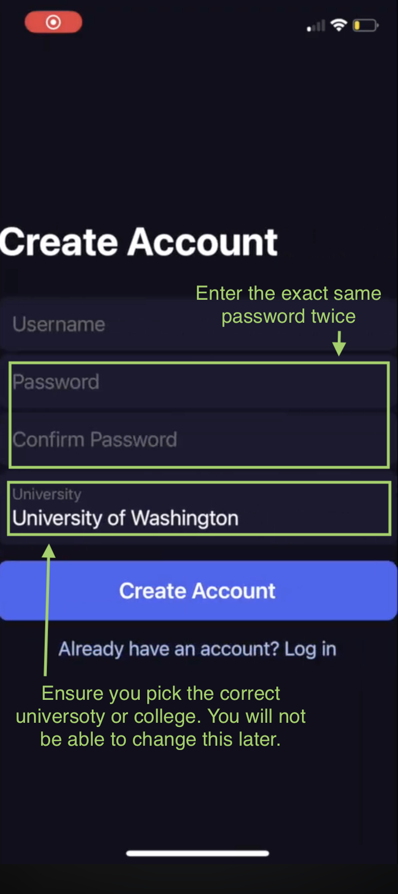
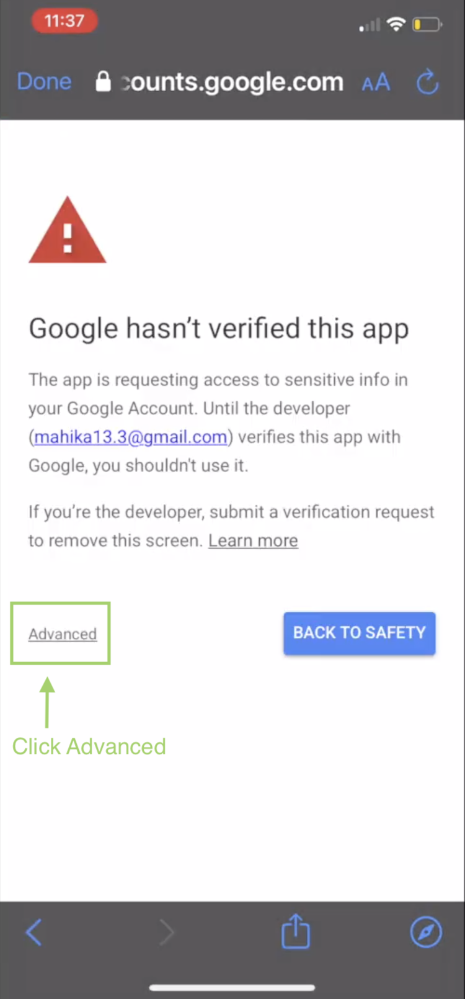

# Campus Eats

**Version:** 1.0 (MVP)

**Contributors:** Mahika Bagri

---

## Table of Contents
<ul>
  <li><a href="#creating-an-account">Creating an Account</a>
  <li><a href="#scheduling-your-meals">Scheduling your Meals</a>
  <li><a href="#viewing-and-updating">Viewing and Updating</a>
  <li><a href="#settings-and-privacy">Settings and Privacy</a>
</ul>

---

## Creating an Account 

 

---

## Scheduling your Meals 

#### Connecting to Google Calendar
    
---

## Viewing and Updating 

#### Preferences

#### Nutrient Tracking 

#### Menus

#### Maps

---

## Settings and Privacy 

#### Location Services   

#### Notifications

---
